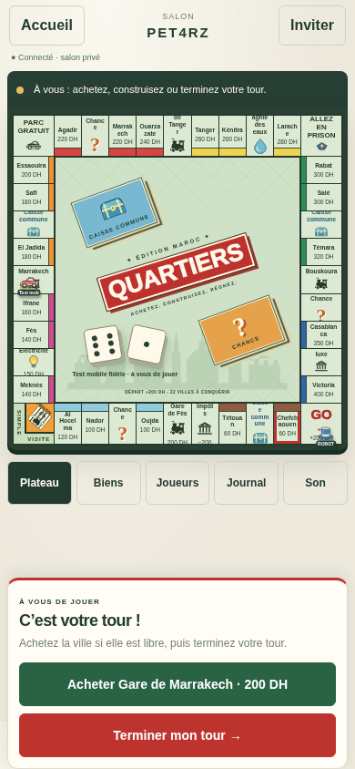

# Quartiers Maroc pour Android — version 1.0.8

[**Télécharger l’APK mis à jour**](https://github.com/saidarifiwork-ai/Monopoly-APK/raw/refs/heads/flutter-android-download/downloads/quartiers-maroc-android-arm64-v1.0.8.apk)

Environ 18 Mo. Android 7 minimum, téléphone ARM64, connexion Internet obligatoire. La signature est identique à la version 1.0.0 publiée ici : installer la mise à jour par-dessus l’application précédente.

Cette version reprend **le vrai plateau du site**, ses pions SVG, les dés, les cartes, les sons et les animations. L’accueil est en Flutter ; les fichiers originaux du jeu sont embarqués dans l’APK. Les commandes sont adaptées au tactile, avec des onglets Biens / Joueurs / Journal / Son et les actions en bas de l’écran.

L’aperçu du rendu embarqué est contrôlé dans Chromium à une taille de téléphone ; il ne constitue pas un essai sur téléphone physique. Les tests de l’application et de l’API, les vérifications du rendu original et la signature de l’APK ont été contrôlés. La somme SHA-256 est fournie dans le fichier voisin.

Version d’essai signée avec une clé de développement, pas une publication Google Play. Le serveur configuré est `https://monopoly-bw6e.onrender.com`, modifiable dans les réglages de l’accueil. Les joueurs web doivent ouvrir cette même adresse Render. Les salons sont stockés en mémoire et sont perdus lors d’un redémarrage du serveur.

Le code se trouve dans `../mobile/`. Le fichier sans numéro de version est aussi actualisé pour les anciens liens.

## Démarrage — version 1.0.2

L’interface apparaît avant la lecture des réglages ; un délai limite et une reprise sont prévus si cette lecture échoue. Le stockage Android utilise l’implémentation par canaux 2.4.28 et le moteur Flutter utilise Skia pour améliorer la compatibilité d’affichage. Treize tests automatisés réussissent. L’écran blanc signalé sur un Xiaomi 12 Pro Android 15 doit encore être confirmé comme résolu sur cet appareil. Aucun essai Android complet n’est revendiqué : l’émulateur sans accélération matérielle n’a pas terminé son démarrage système.

L’accueil est toujours présenté au lancement, y compris après la restauration d’une session : le bouton « Reprendre ma partie » ouvre ensuite le jeu. Un délai limite protège aussi le chargement du rendu embarqué, avec les boutons de reprise et d’accueil.

## Serveur — version 1.0.3

Le serveur par défaut devient Render. Les anciennes installations utilisant l’adresse Vercel par défaut sont redirigées vers Render, sans reprendre une session appartenant à Vercel. Les adresses personnalisées sont conservées. La disponibilité du serveur Render reste à vérifier : le proxy de cet environnement bloque l’accès à ce domaine (HTTP 403).

## Dépôt commun — version 1.0.4

Les changements du dépôt web `Demnatikhalid/monopoly` (commit `aa97d1fb23d516acdf67c8bb3d44c36162e952c4`) sont intégrés au serveur et au rendu embarqué. Le plateau reste celui du site ; les indicateurs de joueurs inactifs sont partagés. Les 14 tests passent, y compris contre le serveur Node.js commun local. Une partie solo a aussi été ouverte dans Chromium avec 40 cases. Ces vérifications ne constituent pas un essai sur téléphone physique. Le raccordement du service Render à ce dépôt reste à effectuer selon [le guide](../docs/DEPOT-COMMUN.md).

## Déconnexions — version 1.0.5

Après 30 secondes sans requête, le joueur apparaît déconnecté ; après 2 minutes, un robot temporaire prend le relais en conservant ses biens. Le retour avec sa session rend le contrôle au joueur. « Quitter la partie » permet le relais immédiat avec confirmation et conserve la possibilité de reprendre sur le même appareil. Voir [le fonctionnement détaillé](../docs/DECONNEXIONS.md). Les tests de présence, de l’API et du navigateur sont effectués localement ; la mise à jour sur téléphone physique reste à vérifier.

## Enchères et délai — version 1.0.6

Le robot prend le relais après 60 secondes d’absence (signalement après 30 secondes). Les terrains, gares et compagnies non achetés sont mis aux enchères : première offre dès 1 DH, réponse en 15 secondes, attribution au plus offrant. Le site propose un lien GitHub vers le dernier APK public. Neuf tests serveur et quinze tests Flutter/API passent ; une enchère à 1 DH est vérifiée dans Chromium. Aucun essai sur téléphone physique n’est revendiqué.

## Achat et victoire — version 1.0.7

Une arrivée sans argent suffisant ne lance plus automatiquement les enchères : « Hypothéquer mes biens » permet de réunir la somme, puis d’acheter au prix normal. Les enchères restent disponibles sur choix explicite ou en terminant le tour sans acheter. La victoire affiche une coupe, le pion du gagnant, des confettis rouges et verts et une fanfare avec applaudissements respectant le son et les animations réduites. L’interface et le raccourci d’hypothèque sont vérifiés dans Chromium à une taille de téléphone ; aucun essai physique Android n’est revendiqué.

## Mode auto — version 1.0.8

Une case « 🤖 Mode auto » apparaît près du nom du joueur connecté pendant le tirage de l’ordre et la partie. Cochée : le robot contrôle cette place. Décochée : le même joueur reprend le contrôle. Les actualisations et reconnexions ne désactivent pas ce choix. Le contrôle concerne uniquement la session authentifiée ; les biens restent ceux du joueur. Quatorze tests serveur et quinze tests Flutter/API passent ; le contrôle de la case est vérifié dans Chromium à une taille de téléphone. Aucun essai sur téléphone physique n’est revendiqué.
